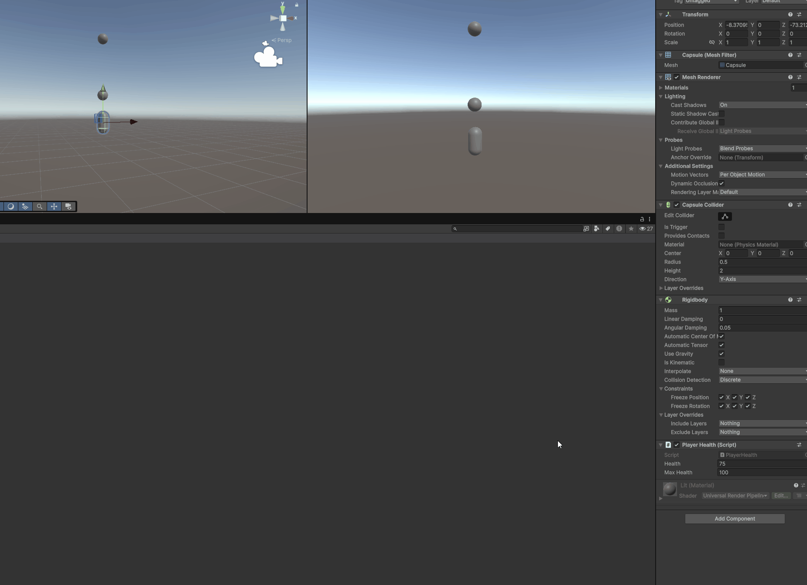

# Unity-project - Levi Plat

Dit is mijn Unity-project voor Software Development op het Mediacollege Amsterdam, klas SD1B.

## Over het project

In dit project oefen ik met C#-scripts, bewegen, botsingen en het oppakken van voorwerpen.

- **SampleScene:** oefeningen met beweging en het verzamelen van voorwerpen.
- **HealthPickup:** een oefening waarbij een pickup de gezondheid van de speler verhoogt. De gezondheid kan niet boven het maximum uitkomen. Als de gezondheid al vol is, blijft de pickup staan.

## Project openen

1. Clone deze repository naar je computer.
2. Open Unity Hub en voeg de gekloonde projectmap toe.
3. Open het project met **Unity 6000.6.0f1**.
4. Open een scene uit `Assets/Scenes`, bijvoorbeeld `HealthPickup.unity`.
5. Klik op **Play** om de scene te starten. Klik opnieuw op Play om te stoppen.

## Belangrijke scripts

- `Assets/script/PlayerHealth.cs`: bewaart de huidige en maximale gezondheid.
- `Assets/script/HealthPickup.cs`: herstelt gezondheid bij een botsing met de trigger en verwijdert een gebruikte pickup.
- `Assets/script/PlayerMovment.cs`: bevat een oefening met bewegen en springen.

## Schermopname

De onderstaande GIF is een opname van mijn HealthPickup-oefening in Unity.



## Git en GitHub

De repository bevat de projectbestanden uit `Assets`, `Packages` en `ProjectSettings`.
De Unity-`.gitignore` houdt gegenereerde mappen zoals `Library`, `Temp` en `Logs` buiten Git.

Om een wijziging naar GitHub te sturen:

```bash
git status
git add README.md Assets Packages ProjectSettings images
git commit -m "Beschrijf de wijziging"
git push
```
